# Augmenting Library Development by Mining Usage Data from Downstream Dependencies

[Christoph Thiede](https://orcid.org/0000-0002-7442-8216), [Willy Scheibel](https://orcid.org/0000-0002-7885-9857), [Daniel Limberger](https://orcid.org/0000-0002-9111-4809), and [Jürgen Döllner](https://orcid.org/0000-0002-8981-8583)

*Proceedings of the 17th International Conference on Evaluation of Novel Approaches to Software Engineering - ENASE (ENASE '22)*, April 25–26, 2022, online. SciTePress, pp. 221–232.

[](https://doi.org/10.5220/0011093700003176) [](https://doi.org/10.5281/zenodo.24121768) [](https://www.researchgate.net/publication/360231022)

Tool and project: [LinqLover/downstream-repository-mining](https://github.com/LinqLover/downstream-repository-mining) ([Zenodo](https://doi.org/10.5281/zenodo.6338060)).

> Software and its dependencies build up a graph where edges connect packages according to their dependencies.
> In this graph, downstream dependencies are all the nodes that depend on a package of interest.
> Although gathering and mining such downstream dependencies allow for informed decision-making for a package developer, there is much room for improvement, such as automation and integration of this approach into their development process.
> This paper makes two contributions: (i) We propose an approach for efficiently gathering downstream dependencies of a single package and extracting usage samples from them using a static type analyzer. (ii) We present a tool that allows npm package developers to survey the aggregated usage data directly in their IDE in an interactive and context-sensitive way.
> We evaluate the approach and the tool on a selection of open source projects and specific development-related questions with respect to found downstream dependencies, gathering speed, and required storage.
> Our methods return over 8000 downstream dependencies for popular packages and process about 12 dependencies per minute.
> The usage sample extraction offers high precision for basic use cases.
> The main limitations are the exclusion of unpopular and closed-source downstream dependencies as well as failing analysis when encountering complex build configurations or metaprogramming patterns.
> To summarize, we show that the tool supports package developers in gathering usage data and surveying the use of their packages and APIs within their downstream dependencies, allowing for informed decision-making and improving the resdesign of APIs.

<p><a href="thiede2022-downstream-mining-as-submitted.pdf">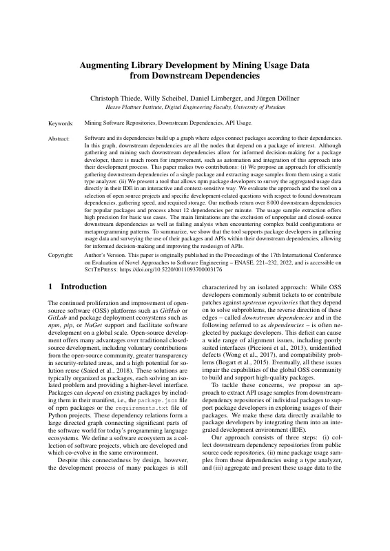</a> <a href="thiede2022-downstream-mining-as-submitted.pdf">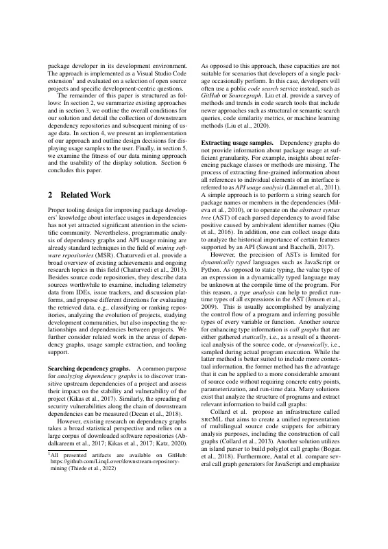</a> <a href="thiede2022-downstream-mining-as-submitted.pdf">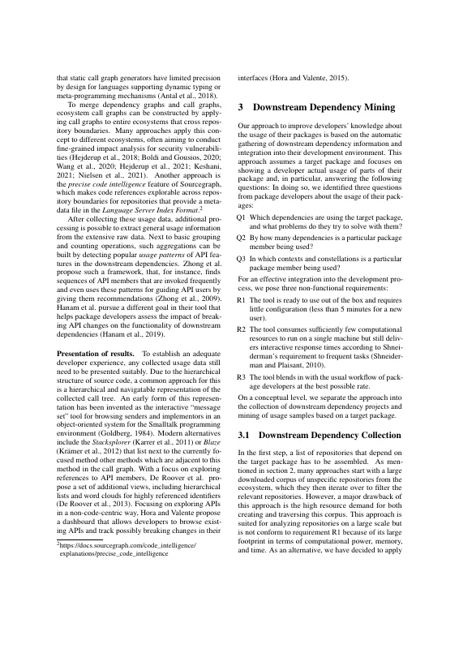</a> <a href="thiede2022-downstream-mining-as-submitted.pdf">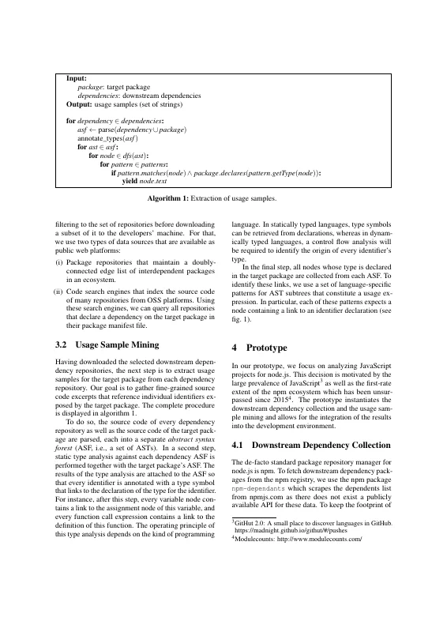</a></p>
<details><summary>Remaining 8 pages</summary><p><a href="thiede2022-downstream-mining-as-submitted.pdf">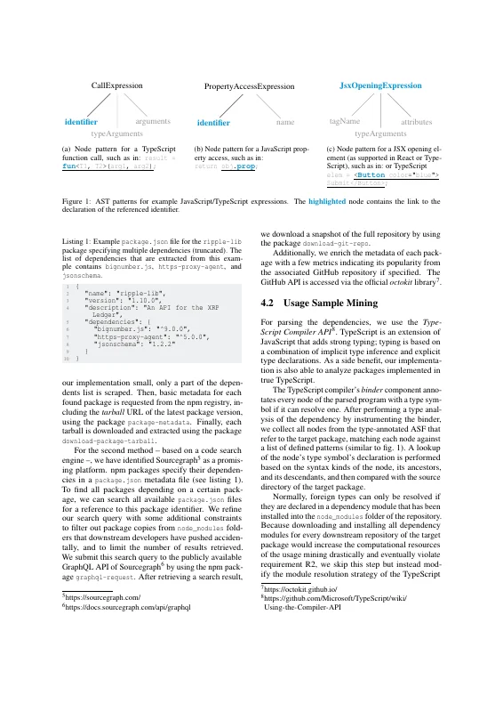</a> <a href="thiede2022-downstream-mining-as-submitted.pdf">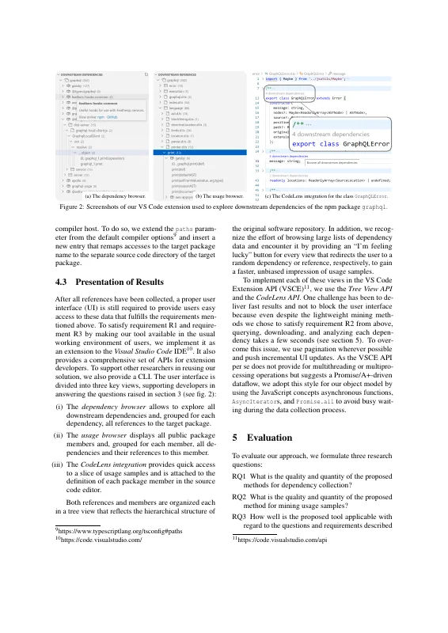</a> <a href="thiede2022-downstream-mining-as-submitted.pdf">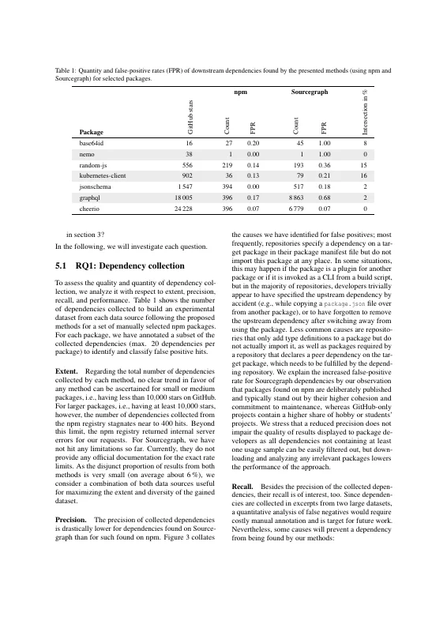</a> <a href="thiede2022-downstream-mining-as-submitted.pdf">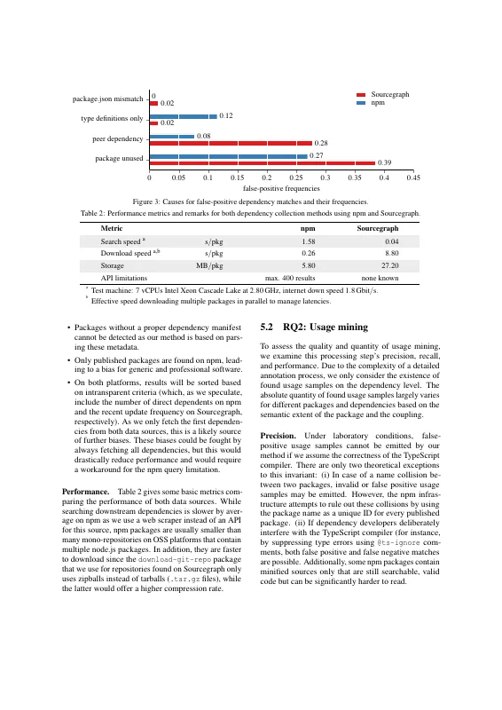</a> <a href="thiede2022-downstream-mining-as-submitted.pdf">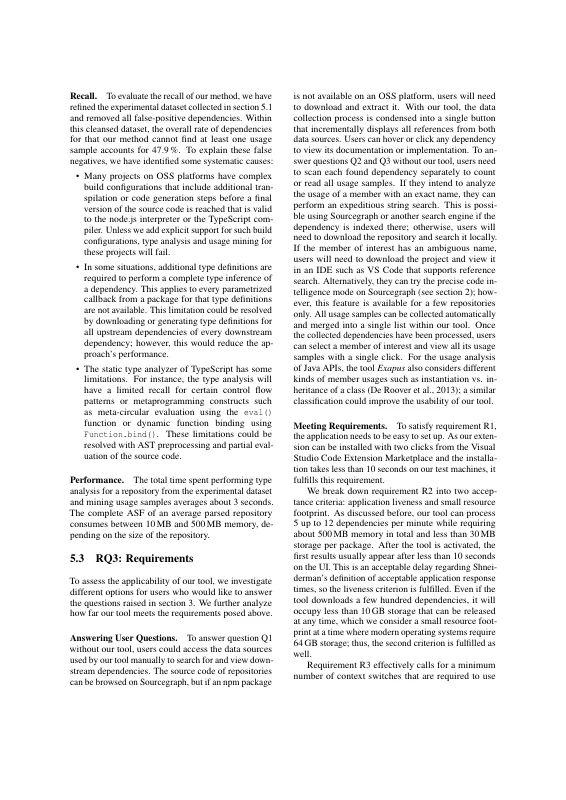</a> <a href="thiede2022-downstream-mining-as-submitted.pdf">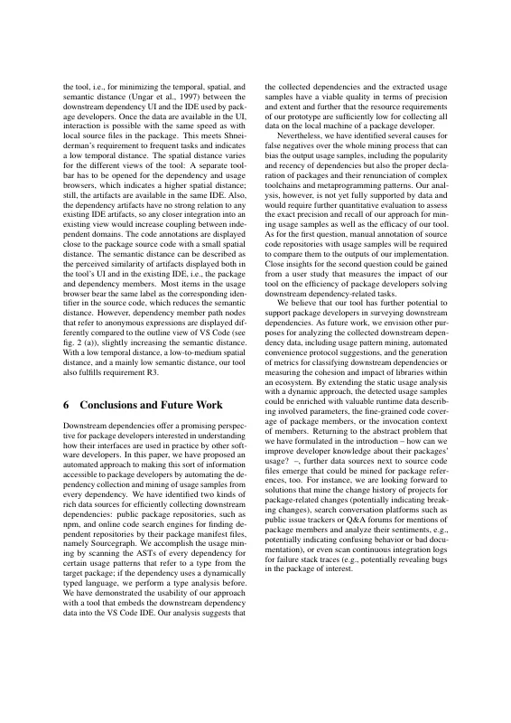</a> <a href="thiede2022-downstream-mining-as-submitted.pdf">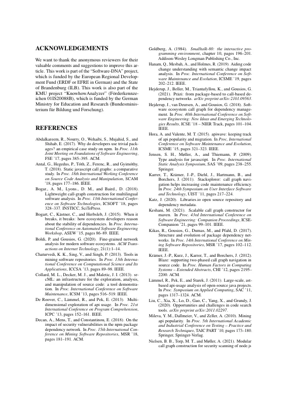</a> <a href="thiede2022-downstream-mining-as-submitted.pdf">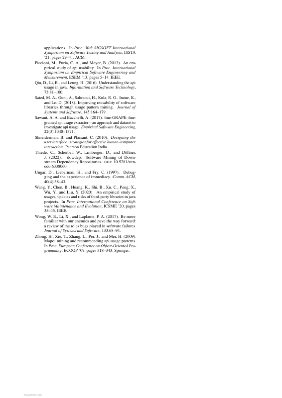</a></p></details>

## Contents

- [`src/`](src/) – LaTeX sources of the author's version (SciTePress conference template), from `docs/ENASE2022/camera-ready/` of the project repository
- [`thiede2022-downstream-mining-as-submitted.pdf`](thiede2022-downstream-mining-as-submitted.pdf) – author's version as published on ResearchGate (without the ResearchGate cover page); the publisher's typeset version differs only in header/footer
- [`build.sh`](build.sh) – reproducible build with TeX Live 2021 (podman or docker)
- [`preview/`](preview/) – page previews for this README

## Build

```bash
./build.sh        # → build/paper.pdf
```

The SciTePress template files (`article.cls`, `SCITEPRESS.sty`, `apalike.sty`, `apalike.bst`) are bundled in `src/` and take precedence over the TeX Live versions.
`thiede2022-downstream-mining-as-submitted.pdf` was built with TeX Live 2021 (pdfTeX 1.40.23), hence the TeX Live 2021 container; the build reproduces it (identical text and layout).
On `main`, the build produces the revised version (`v1.1-revised`). Check out `v1.0-camera-ready` to reproduce `thiede2022-downstream-mining-as-submitted.pdf`.
The build compiles a scratch copy of `src/` inside the container, so the ORCID logo (`orcid.eps`, used from `v1.1-revised` on) can be converted to PDF.

The only source change against the project repository: the path of `measurements/fpr.csv` (the original pointed to the copy in `docs/ENASE2022/manuscript/`, which only resolves when compiling from the repository root).

## Versions

- [`v1.0-camera-ready`](https://github.com/dl-archive/article.2022-enase-downstream-mining/tree/v1.0-camera-ready) – sources of the author's version (camera-ready plus the SciTePress author-version notice on the first page)
- [`v1.1-revised`](https://github.com/dl-archive/article.2022-enase-downstream-mining/tree/v1.1-revised) – author's revised version (2026-11-11): ORCID iDs, grammar and typo fixes, see [Revisions](#revisions)

## Revisions

`v1.1-revised` (2026-11-11) corrects errors in the author's version without changing its content or layout.
Every page carries the note "Author's revised version (2026-11-11). Version of record: https://doi.org/10.5220/0011093700003176".

- ORCID iDs of all authors as linked icons next to their names (footnotes would reflow the first page).
- Typos and leftover fragments: "redesign" (abstract, was "resdesign"), "navigable", a stray "or TypeScript" in the caption of Figure 2 (c), and the colon after "answering the developers' questions." that led into the next paragraph.
- Parentheses: closed "(for instance, … comments)", opened "(e.g., potentially indicating …)", closed "(e.g., potentially revealing bugs …)".
- Grammar and word choice: "in their development environment", "false positives", "runtime", "metaprogramming", "such a framework that", "requirement for frequent tasks" (2×), "does not conform to", "allows exploring", "counteract it", "than for those found on npm", "is a target for future work", "slower on average", "for which" (2×).

## Citation

```bibtex
@InProceedings{thiede2022-downstream-mining,
  author    = {Thiede, Christoph and Scheibel, Willy and Limberger, Daniel and D{\"o}llner, J{\"u}rgen},
  title     = {Augmenting Library Development by Mining Usage Data from Downstream Dependencies},
  booktitle = {Proceedings of the 17th International Conference on Evaluation of Novel Approaches to Software Engineering - ENASE},
  year      = {2022},
  series    = {ENASE~'22},
  publisher = {SciTePress},
  organization = {INSTICC},
  pages     = {221--232},
  doi       = {10.5220/0011093700003176},
  isbn      = {978-9-897585-68-5},
}
```
